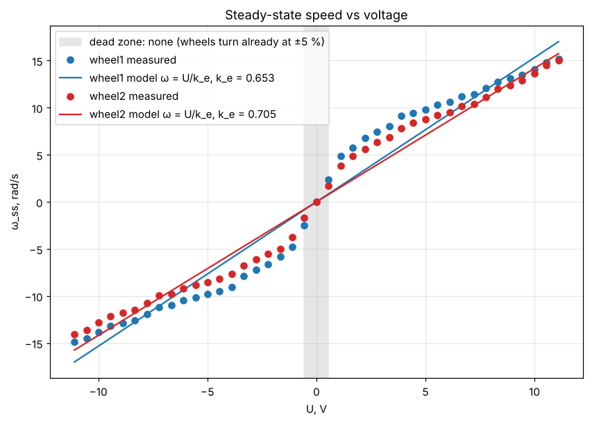
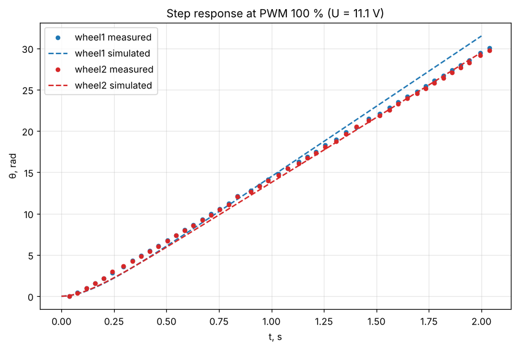

# Lab 5 – DC motor parameter identification

## Experiment

The robot stood on a support with **both drive wheels spinning freely in the air** (no load). The block program `motor_identification.qrs` drives M3 (wheel 1, left, encoder E3) and M4 (wheel 2, right, encoder E4) together with the same PWM, sweeping from −100 % to +100 % in steps of 5 % (41 levels). For each level it

1. clears both encoders and waits 0.5 s,
2. applies the PWM step and samples `time, E3, E4` every loop pass for 2 s (median period 41.7 ms, 34–48 samples per level),
3. stops the motors and only then writes the samples to `motor_data.txt` (no file I/O inside the sampling loop),
4. waits 1 s for the wheels to stop.

Each line of `motor_data.txt` is `PWM_%  t_ms  E3_deg  E4_deg  battery_V`. The TRIK block language cannot read the battery, so the last column is `0`; the battery voltage read on the robot before the run, **U_bat = 11.1 V**, is set in the notebook (`BATTERY_V`). It only scales U and therefore k_e; T_m and ω_ss do not depend on it.

## Method

Model of the motor (inductance neglected), with the applied voltage U = PWM/100 · U_bat:

```
T_m · dω/dt + ω = U / k_e,      dθ/dt = ω
θ(t) = ω_ss · (t − T_m + T_m · e^(−t/T_m)),    ω_ss = U / k_e
```

- Every run is fitted for both wheels with `scipy.optimize.curve_fit` → ω_ss and T_m. A run with less than 15° of rotation would count as "did not move" (dead zone).
- k_e is the least-squares slope of ω_ss = U/k_e through the origin over |PWM| ≥ 30 % (lower levels are distorted by friction), for both directions together, forward and reverse.
- T_m is summarised by the median over the same runs.
- The identified model is simulated with `odeint` and compared with the measurement.

All steps are in **[identification.ipynb](identification.ipynb)**.

## Results

| Wheel | k_e, V·s/rad | k_e fwd / rev, V·s/rad | T_m (median, \|PWM\| ≥ 30 %), s | T_m range, s | dead zone |
|---|---:|---:|---:|---:|---|
| 1 – left (M3/E3) | 0.653 | 0.647 / 0.658 | 0.149 | 0.058–0.282 | none at ±5 % |
| 2 – right (M4/E4) | 0.705 | 0.688 / 0.724 | 0.126 | 0.055–0.255 | none at ±5 % |

### T_m and ω_ss for every PWM level

| PWM, % | U, V | ω_ss wheel 1, rad/s | T_m wheel 1, s | ω_ss wheel 2, rad/s | T_m wheel 2, s |
|---:|---:|---:|---:|---:|---:|
| -100 | -11.10 | -14.84 | 0.058 | -14.03 | 0.064 |
| -95 | -10.54 | -14.46 | 0.067 | -13.58 | 0.060 |
| -90 | -9.99 | -13.81 | 0.085 | -12.81 | 0.078 |
| -85 | -9.43 | -13.19 | 0.117 | -12.13 | 0.090 |
| -80 | -8.88 | -12.91 | 0.117 | -11.80 | 0.103 |
| -75 | -8.32 | -12.58 | 0.122 | -11.49 | 0.103 |
| -70 | -7.77 | -11.93 | 0.165 | -10.72 | 0.135 |
| -65 | -7.21 | -11.15 | 0.177 | -9.94 | 0.169 |
| -60 | -6.66 | -10.98 | 0.204 | -9.76 | 0.181 |
| -55 | -6.11 | -10.43 | 0.224 | -9.22 | 0.197 |
| -50 | -5.55 | -10.17 | 0.239 | -8.85 | 0.112 |
| -45 | -5.00 | -9.81 | 0.228 | -8.52 | 0.209 |
| -40 | -4.44 | -9.45 | 0.258 | -8.16 | 0.213 |
| -35 | -3.88 | -9.02 | 0.282 | -7.67 | 0.212 |
| -30 | -3.33 | -7.85 | 0.120 | -6.76 | 0.255 |
| -25 | -2.77 | -7.21 | 0.109 | -6.14 | 0.062 |
| -20 | -2.22 | -6.64 | 0.355 | -5.51 | 0.279 |
| -15 | -1.66 | -5.78 | 0.371 | -4.97 | 0.039 |
| -10 | -1.11 | -4.76 | 0.375 | -3.75 | 0.295 |
| -5 | -0.56 | -2.53 | 0.662 | -1.70 | 0.345 |
| 0 | 0.00 | 0.00 | — | 0.00 | — |
| 5 | 0.56 | 2.35 | 0.503 | 1.67 | 0.393 |
| 10 | 1.11 | 4.88 | 0.445 | 3.86 | 0.309 |
| 15 | 1.66 | 5.76 | 0.353 | 4.85 | 0.317 |
| 20 | 2.22 | 6.78 | 0.363 | 5.60 | 0.039 |
| 25 | 2.77 | 7.47 | 0.338 | 6.32 | 0.289 |
| 30 | 3.33 | 8.00 | 0.273 | 6.82 | 0.213 |
| 35 | 3.88 | 9.13 | 0.274 | 7.85 | 0.217 |
| 40 | 4.44 | 9.47 | 0.244 | 8.38 | 0.227 |
| 45 | 5.00 | 9.82 | 0.132 | 8.80 | 0.100 |
| 50 | 5.55 | 10.30 | 0.224 | 9.23 | 0.210 |
| 55 | 6.11 | 10.58 | 0.215 | 9.54 | 0.191 |
| 60 | 6.66 | 11.19 | 0.210 | 10.17 | 0.182 |
| 65 | 7.21 | 11.39 | 0.190 | 10.42 | 0.160 |
| 70 | 7.77 | 12.05 | 0.117 | 11.14 | 0.098 |
| 75 | 8.32 | 12.72 | 0.132 | 11.98 | 0.116 |
| 80 | 8.88 | 13.14 | 0.108 | 12.39 | 0.107 |
| 85 | 9.43 | 13.45 | 0.111 | 12.87 | 0.104 |
| 90 | 9.99 | 14.06 | 0.087 | 13.61 | 0.077 |
| 95 | 10.54 | 14.78 | 0.071 | 14.53 | 0.065 |
| 100 | 11.10 | 15.19 | 0.058 | 15.02 | 0.055 |

### T_m vs voltage


### Steady-state speed vs voltage



### Step response, measured vs simulated



## Discussion

The linear model fails mainly at low and medium voltage. With the wheels in the air there is no dead zone at ±5 %, but just above zero the speed jumps up much faster than ω_ss = U/k_e predicts (at 10 % PWM the model gives 1.7 rad/s instead of the measured 4.9 rad/s), and at 100 % it over-predicts by about 13 %, so ω_ss(U) is a curve, not one straight line. T_m is not constant either: it falls from about 0.35–0.66 s near ±5 % to about 0.06 s at ±100 %, so one median value describes the start of the motion only roughly; a few low-level fits (e.g. 0.04 s) are outliers caused by the slow and uneven sampling (up to 130 ms between samples). The two wheels differ clearly: at the same PWM wheel 1 turns 1 % faster at 100 %, about 11 % faster at 50 % and over 20 % faster at 10 %, which also gives different k_e (0.653 vs 0.705 V·s/rad). For next week's odometry this means that equal power on both motors will not drive straight — with r = 0.0375 m and track 0.194 m the robot would turn about 30° per metre at 50 % (estimated from the free-spinning speeds; on the floor the load changes the numbers) — so the pose must be integrated from the measured encoder speeds of each wheel, not from the commanded PWM and one shared motor model.
